<!-- ==================== HERO ==================== -->

<!-- Typing animation. Edit the lines= phrases to change the rotating text. -->

 

<!-- Contact badges. Edit the links here. -->

---

<!-- ==================== ABOUT ==================== -->
## About

Data Analyst with one year of hands-on experience building automated ETL pipelines, tuning relational databases, and deploying Generative AI and Agentic AI workflows. I turn high-volume, messy data into dashboards and systems people rely on daily.

<!-- Four metrics. Edit the numbers and labels here. -->

<table>
  <tr>
    <td align="center" width="25%"><h3>1.4M+</h3>records processed monthly</td>
    <td align="center" width="25%"><h3>82%</h3>faster SQL execution</td>
    <td align="center" width="25%"><h3>15K+</h3>documents indexed in a RAG assistant</td>
    <td align="center" width="25%"><h3>16 hrs</h3>analyst time saved weekly</td>
  </tr>
</table>

---

<!-- ==================== EXPERIENCE ==================== -->
## Experience

### Vangrove Tech · Data Analyst
**October 2025 – October 2026 · Hyderabad, India**

- Developed Python ETL pipelines processing **1.4M+ monthly transactions** with **99.4% data integrity**
- Optimized SQL queries, reducing execution time by **82%** (4.2 minutes to 45 seconds) across **1.2M+ records**
- Developed **5 Power BI and Tableau dashboards**, saving **16 analyst-hours per week**
- Built an enterprise RAG assistant across **15K+ documents**, reducing information retrieval time by **75%**
- Developed an AutoGen multi-agent auditor, reducing weekly triage time from **14 hours to 35 minutes**

---

<!-- ==================== PROJECTS ==================== -->
## Featured Projects

<!-- Two project cards. Edit the text here. -->
<table>
  <tr>
    <td width="50%" valign="top">
      <h3>Hand Gesture Controlling System</h3>
      
      
      
      
Computer vision system that recognizes hand gestures from a webcam feed to control the computer.

    </td>
    <td width="50%" valign="top">
      <h3>AI-Based Surveillance System</h3>
      
      
      
      
Video monitoring system using OpenCV for frame processing and TensorFlow for detection models.

    </td>
  </tr>
</table>

---

<!-- ==================== ACHIEVEMENTS ==================== -->
## Achievements

<table>
  <tr>
    <td width="50%" align="center" valign="top">
      <h3>🏆 1st Place</h3>
      <b>BRAIN-O-VISION AWS Hackathon 2023</b> 
      Scalable AWS cloud infrastructure and a full-stack web application
    </td>
    <td width="50%" align="center" valign="top">
      <h3>🏆 Healthcare Winner</h3>
      <b>METALOOP 2023 Hackathon</b> 
      Interactive Unity VR visualization of molecular structures
    </td>
  </tr>
</table>

---

<!-- ==================== TECH STACK ==================== -->
## Tech Stack

<!-- Edit or add badges per category. -->
**Programming:**   

**Data Analytics:**    

**Visualization:**  

**Databases:**  

**AI & Machine Learning:**     

**Cloud & Tools:**   

---

<!-- ==================== GITHUB ANALYTICS ==================== -->
## GitHub Analytics

<!-- Replace USERNAME in every URL below. -->

 

 

  

<!-- Contribution snake. Generated by .github/workflows/snake.yml -->
<picture>
  <source media="(prefers-color-scheme: dark)" srcset="dist/github-contribution-grid-snake-dark.svg"/>
  
</picture>

---

<!-- ==================== CERTIFICATIONS ==================== -->
## Certifications

| Certification | Issuer |
|---|---|
| Python Programming | Udemy |
| C Programming | HackerRank |
| Integrated AI | Rinex |

---

<!-- ==================== CONTACT ==================== -->
## Connect

  

<!-- Footer banner -->

<a href="#hero">Back to top</a>

